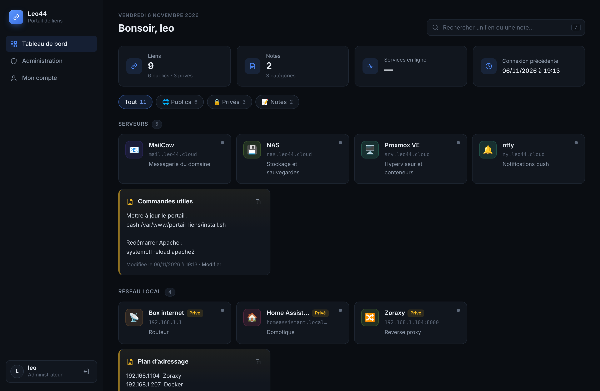
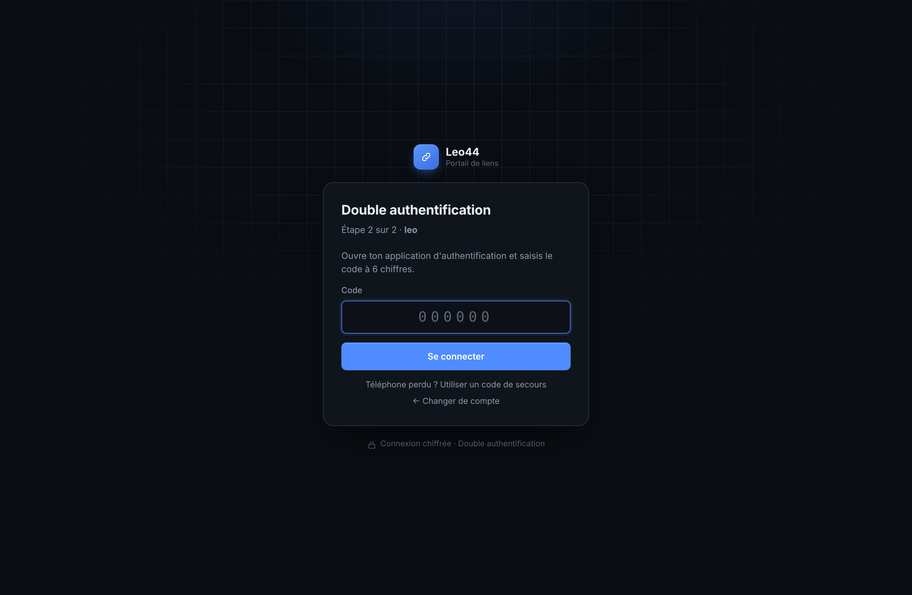
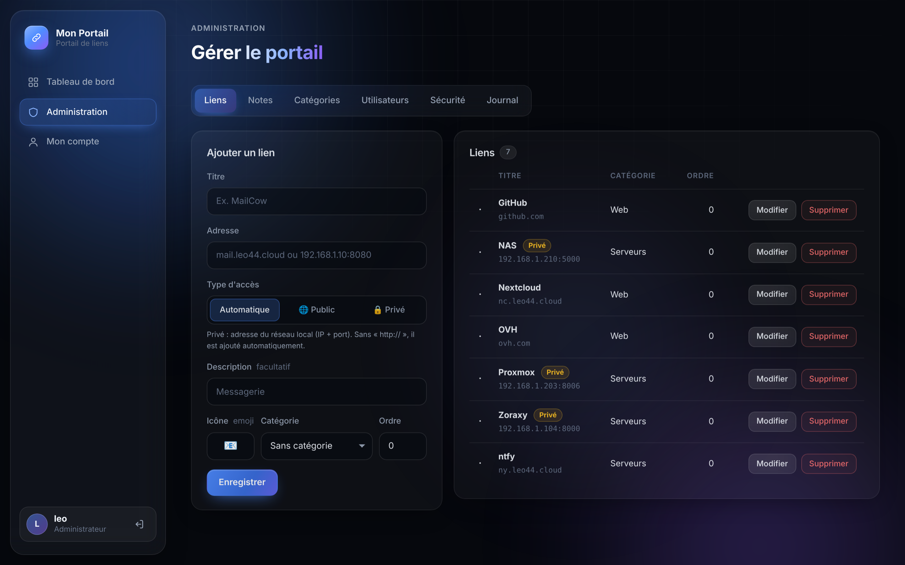
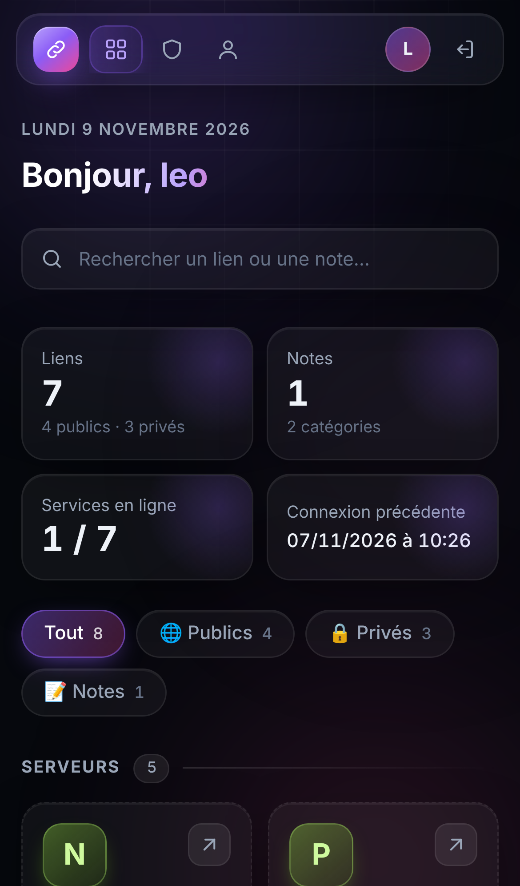

# Portail de liens

Tableau de bord personnel en PHP pour regrouper ses liens (sites publics **et** appareils du réseau local en IP:port) et des notes texte, derrière une connexion sécurisée avec **double authentification**.



## Fonctionnalités

- **Accès réservé aux comptes connectés** : mot de passe + code à 6 chiffres (Google Authenticator, Authy, Mots de passe d'iPhone…), activé obligatoirement à la première connexion.
- **Liens publics et privés** : tape `mail.mondomaine.fr` ou `192.168.1.20:8006`, le type est détecté tout seul (badge « Privé » pour le réseau local).
- **Notes texte** : mémos, commandes, plan d'adressage… avec bouton Copier.
- **Catégories**, **recherche** instantanée (touche `/`) et filtres Tout / Publics / Privés / Notes.
- **État des services** : pastille verte ou rouge pour chaque lien, vérifiée depuis le serveur.
- **Administration** : liens, notes, catégories, comptes (mot de passe provisoire, réinitialisation 2FA, droits admin) et journal de sécurité.
- **Alertes ntfy** sur le téléphone : connexion, essais ratés, code 2FA faux, adresse bloquée (onglet Administration → Sécurité).
- **Thème sombre**, adapté au téléphone.

| Double authentification | Administration | Mobile |
|---|---|---|
|  |  |  |

## Installation (Debian 13)

En **root** sur le serveur :

```bash
wget -qO install.sh https://raw.githubusercontent.com/leochgn-collab/portail-liens/main/install.sh
bash install.sh
```

Le script installe Apache, PHP 8.4 et SQLite, télécharge le portail dans `/var/www/portail-liens`, configure Apache et crée le compte administrateur. Il pose 5 questions :

| Question | Exemple |
|---|---|
| Domaine du portail | `leo44.cloud` |
| Nom affiché | `Leo44` |
| Accès : **1** derrière un reverse proxy (Zoraxy…) ou **2** direct avec certbot | `1` |
| IP du reverse proxy (choix 1) | `192.168.1.104` |
| Identifiant admin | `leo` |

À la fin, il affiche un **mot de passe provisoire**. Ouvre le site, connecte-toi, scanne le QR code, note tes codes de secours, puis choisis ton mot de passe.

### Avec Zoraxy

Dans Zoraxy, crée une règle de proxy `leo44.cloud → http://IP-du-serveur:80` et active le HTTPS. Le portail fait confiance à l'IP du proxy indiquée pendant l'installation pour connaître l'adresse réelle des visiteurs (utile pour bloquer les essais de mot de passe) et savoir que la connexion est chiffrée.

## Application sur le téléphone

Le portail s'installe comme une application :
- **iPhone** : ouvre le site dans Safari → bouton Partager → « Sur l'écran d'accueil ».
- **Android** : Chrome → menu ⋮ → « Installer l'application ».

Lors de la double authentification, coche **« Faire confiance à cet appareil »** (case pré-cochée dans l'application installée) : l'appareil reste connecté sans mot de passe ni code pendant 90 jours après sa dernière utilisation (`TRUST_DAYS`). Les appareils de confiance sont listés dans **Mon compte**, où tu peux les retirer ; changer de mot de passe ou réinitialiser la 2FA les retire tous, et la déconnexion retire l'appareil utilisé. Une alerte ntfy est envoyée à chaque nouvel appareil de confiance.

**Face ID** : sur un appareil de confiance, *Mon compte → Activer Face ID sur cet appareil* crée une clé d'accès protégée par Face ID (ou Touch ID / code de l'appareil). L'application se verrouille ensuite après 2 minutes sans activité (`FACEID_LOCK`, en secondes) et demande Face ID pour se rouvrir ; « Utiliser mon mot de passe » reste possible (mot de passe + code 2FA). Seule la clé publique est stockée sur le serveur, qui vérifie la signature à chaque déverrouillage.

En console : `$P forget-devices nom` retire tous les appareils de confiance d'un compte.

## Mise à jour

```bash
bash /var/www/portail-liens/install.sh
```

Les comptes, liens, notes et réglages sont conservés.

## Commandes utiles

```bash
P="runuser -u www-data -- php /var/www/portail-liens/bin/portail.php"
$P list                     # lister les comptes
$P create-admin nom         # créer un administrateur
$P reset-password nom       # nouveau mot de passe provisoire
$P reset-2fa nom            # téléphone perdu : reconfigurer la 2FA
$P bans                     # adresses IP bloquées
$P unban 1.2.3.4            # débloquer une adresse (unban all : tout débloquer)
```

## Réglages

Dans `/var/www/portail-liens/config.local.php` (créé par l'installation, jamais écrasé) :

```php
<?php
const APP_NAME = 'Leo44';
const TRUSTED_PROXIES = '192.168.1.104';
// const SESSION_IDLE = 1800;   // déconnexion après 30 min d'inactivité
// const STATUS_CHECK = false;  // désactiver les pastilles d'état
```

## Sécurité

- Mots de passe hachés en Argon2id, 12 caractères minimum.
- Secret 2FA chiffré (libsodium), codes à usage unique, 8 codes de secours.
- 5 erreurs par compte en 15 min : compte bloqué 15 min.
- 10 erreurs par IP en 15 min : adresse bloquée 15 min, puis 1 h, puis 24 h si elle recommence.
- Chaque essai raté est ralenti d'une seconde.
- Seules les méthodes GET et POST sont acceptées (PUT, DELETE… refusées).
- Jeton CSRF sur chaque formulaire, cookies `Secure` / `HttpOnly` / `SameSite`, CSP stricte sans script en ligne.
- Base SQLite et clé de chiffrement dans `data/`, **hors** du dossier publié par Apache.
- Journal des connexions et actions sensibles.

À savoir : les liens privés ne s'ouvrent que depuis le réseau local ou un VPN. Les notes sont visibles par tous les comptes connectés : n'y mets pas de mots de passe importants.

## Structure

```
public/      pages accessibles (seul dossier publié par Apache)
src/         configuration, base de données, sécurité, mise en page
bin/         outil en ligne de commande
data/        base SQLite, clé, sessions (créé à l'installation, non versionné)
install.sh   installation et mise à jour
```

## Licence

MIT. Le générateur de QR code (`public/assets/qrcode.js`) est de Kazuhiko Arase, sous licence MIT.

## Page « Rappels »

Chaque compte peut programmer ses propres rappels, envoyés en notification sur ntfy (serveur réglé dans l'administration) :

- **une seule fois**, à une date et une heure précises ;
- **tous les jours**, **chaque semaine** (jours au choix, ex. du lundi au vendredi), **chaque mois** (le 31 tombe le dernier jour des mois plus courts), **chaque année** ou **tous les N jours**.

**Rappel insistant 🔁** : en choisissant le type « Insistant », la notification revient toutes les 5, 10, 15, 30 ou 60 minutes tant que tu n'as pas appuyé sur **✅ C'est fait**, soit directement dans la notification ntfy, soit sur la page Rappels (24 h de relances au maximum). Le bouton de la notification appelle `rappel-ok.php` avec un jeton secret valable pour ce seul rappel en attente ; l'adresse du portail est retenue à l'ouverture de la page Rappels (ou fixée avec `const APP_URL = 'https://leo44.cloud';` dans `config.local.php`).

Options :
- **Fin** des rappels récurrents : jamais, jusqu'à une date, ou après un nombre d'envois.
- **Plus tard** : boutons ⏰ 15 min, 1 h ou demain matin dans la notification (sur un rappel insistant : ✅ C'est fait, ⏰ 15 min et « Plus tard… »). Toucher la notification ouvre une page avec tous les choix.
- **Escalade** : un rappel insistant passe en priorité « Urgente » à la 3e relance (case à décocher si besoin).
- **Heures de silence** par compte (ex. 23:00 → 07:00) : seuls les rappels réglés en « Urgente » partent ; les autres attendent la fin et arrivent avec leur heure d'origine.

Pour chaque rappel : un message facultatif et une priorité ntfy. En haut de la page, chaque compte choisit le **sujet ntfy de tous ses rappels** (vide : celui des alertes du portail) ; un rappel peut quand même avoir son propre sujet. Bouton « Tester » pour un envoi immédiat, pause et reprise.

L'envoi est fait chaque minute par cron (`bin/rappels.php`, dans `/etc/cron.d/portail-ct`, créé par `install.sh`). Si le serveur était éteint à l'heure prévue, le rappel part au redémarrage avec l'heure d'origine. Si ntfy est injoignable, nouvel essai chaque minute et une seule ligne au journal.

## Page « Conteneurs » (Proxmox)

Les administrateurs peuvent démarrer et arrêter proprement leurs CT Proxmox, et programmer des plages d'extinction (ex. éteint de 23:00 à 07:00), affichées sur une frise de 24 h. Le planificateur est lancé chaque minute par cron (`/etc/cron.d/portail-ct`, créé par `install.sh`).

1. Sur l'hôte Proxmox, crée un rôle et un jeton limités :
   ```bash
   pveum role add CTPower -privs "VM.PowerMgmt VM.Audit"
   pveum user token add root@pam portail --privsep 1
   pveum acl modify /vms --tokens 'root@pam!portail' --roles CTPower --propagate 1
   ```
2. Dans `config.local.php` du portail :
   ```php
   const PVE_URL   = 'https://192.168.1.203:8006';
   const PVE_TOKEN = 'root@pam!portail=LE_SECRET';
   ```

3. Pour que le portail vérifie le certificat de Proxmox (recommandé), copie l'autorité de Proxmox dans le CT du portail, depuis l'hôte :
   ```bash
   pct push 106 /etc/pve/pve-root-ca.pem /etc/ssl/certs/pve-root-ca.pem
   ```
   puis ajoute dans `config.local.php` : `const PVE_CA = '/etc/ssl/certs/pve-root-ca.pem';`

Le droit donné sur `/vms` couvre aussi les CT créés plus tard : le portail les détecte dans la minute, les affiche avec un badge « Nouveau » et envoie une alerte ntfy (de même quand un CT est supprimé).

Le CT du portail (106 par défaut, réglable avec `PVE_PROTECTED`) ne peut jamais être arrêté depuis la page.

## Page « Sauvegardes » (Proxmox)

Les administrateurs suivent les sauvegardes Proxmox (vzdump) depuis le portail :

- **prochaine sauvegarde** (date et compte à rebours), **dernière** (réussie ou non, durée), état du **stockage** (joignable, place libre) ;
- **sauvegarde en cours** : barre d'avancement, CT par CT (terminé avec durée et taille, en cours, en attente, en échec), temps écoulé, **temps restant estimé** et heure de fin prévue (d'après les durées des sauvegardes précédentes). La page se recharge toute seule toutes les 15 s pendant une sauvegarde ;
- **tâches planifiées**, **copies présentes** sur le stockage (nombre, dernière copie, taille) et **historique** des 15 dernières sauvegardes.

La page lit seulement. Elle utilise le même jeton que la page Conteneurs, qui a besoin en plus d'un rôle de lecture. Sur l'hôte Proxmox :

```bash
pveum role add PortailAudit -privs "Sys.Audit Datastore.Audit"
pveum acl modify / --tokens 'root@pam!portail' --roles PortailAudit --propagate 1
```

`Sys.Audit` permet de lire les tâches planifiées et le journal des sauvegardes, `Datastore.Audit` la liste des copies sur le stockage. Aucun de ces droits ne permet de modifier quoi que ce soit.

## Page « Réveil réseau » (Wake-on-LAN)

Les administrateurs peuvent allumer à distance un appareil du réseau local (NAS, PC…) avec un bouton, et voir s'il est allumé. Le signal part du serveur du portail : ça marche donc depuis n'importe où, du moment que tu peux ouvrir le portail.

1. Active le Wake-on-LAN sur l'appareil (ReadyNAS : Système → Alimentation → « Activation sur réseau local » ; PC : BIOS + carte réseau) et relève son adresse MAC.
2. Dans `config.local.php` du portail :
   ```php
   const WOL_BROADCAST = '192.168.1.255';   // adresse de diffusion de ton réseau
   const WOL_DEVICES = [
       'nas' => ['name' => 'NAS', 'mac' => 'AA:BB:CC:DD:EE:FF', 'ip' => '192.168.1.201', 'port' => 80],
   ];
   ```
   `ip` et `port` servent à afficher si l'appareil est allumé (un port qui répond quand il tourne : 80 pour une interface web, 22 pour SSH…).
3. Vérifie que PHP a l'extension `sockets` : `php -m | grep sockets` (incluse dans `php8.4-common` sur Debian).

Le portail doit être sur le même réseau que l'appareil (pour un CT Proxmox : carte réseau sur le pont `vmbr0`). Un même appareil ne peut être réveillé qu'une fois par minute, et chaque réveil est noté dans le journal.

### Bouton « Éteindre » (facultatif)

Le portail éteint l'appareil par SSH avec **sa propre clé**, que l'appareil n'accepte **que pour s'éteindre** (commande imposée côté appareil) : même si quelqu'un volait cette clé, il ne pourrait rien faire d'autre. L'appareil doit être allumé, avec SSH activé (ReadyNAS : Système → Paramètres → Services → SSH).

1. Dans le serveur du portail (en root), crée la clé :
   ```bash
   apt install -y openssh-client
   runuser -u www-data -- ssh-keygen -t ed25519 -N '' -C portail-extinction -f /var/www/portail-liens/data/wol_ssh_key
   ```
2. Autorise-la sur l'appareil, limitée à la commande d'extinction (mot de passe root de l'appareil demandé une fois ; sur un ReadyNAS, c'est celui du compte admin). Sur un **ReadyNAS**, utilise `rnutil rn_shutdown` : c'est l'extinction de l'interface Netgear (elle arrête d'abord readynasd, les applis et les disques USB). Sur un autre Linux, remplace-la par `poweroff`.
   ```bash
   cat /var/www/portail-liens/data/wol_ssh_key.pub | ssh root@192.168.1.201 \
     'mkdir -p ~/.ssh && chmod 700 ~/.ssh && sed "s/^/command=\"rnutil rn_shutdown\",no-port-forwarding,no-X11-forwarding,no-agent-forwarding,no-pty /" >> ~/.ssh/authorized_keys && chmod 600 ~/.ssh/authorized_keys'
   ```
3. Ajoute `'ssh' => 'root@192.168.1.201'` à l'appareil dans `WOL_DEVICES` :
   ```php
   'nas' => ['name' => 'NAS', 'mac' => 'AA:BB:CC:DD:EE:FF', 'ip' => '192.168.1.201', 'port' => 80, 'ssh' => 'root@192.168.1.201'],
   ```

Le bouton rouge « Éteindre » apparaît quand l'appareil est allumé, avec une confirmation. Chaque extinction est notée dans le journal.

## Bonus : alertes de connexion Proxmox

`extras/proxmox-ntfy.sh` envoie une notification ntfy quand quelqu'un se connecte à Proxmox (interface web ou SSH), ou se trompe de mot de passe. En root sur le serveur Proxmox :

```bash
wget -qO proxmox-ntfy.sh https://raw.githubusercontent.com/leochgn-collab/portail-liens/main/extras/proxmox-ntfy.sh
bash proxmox-ntfy.sh install
```
