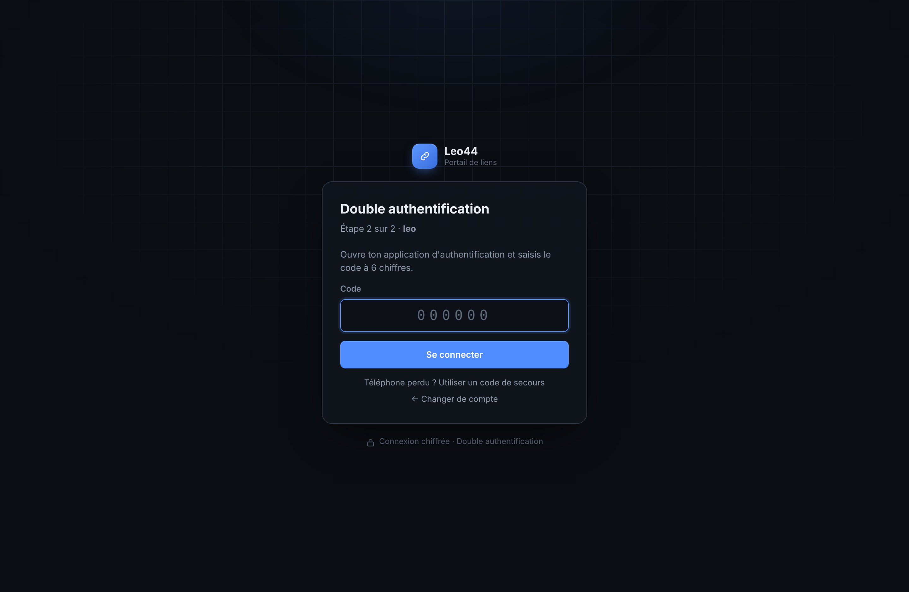
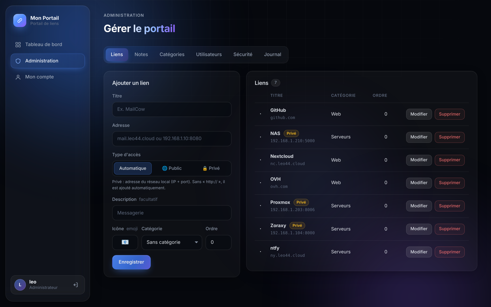
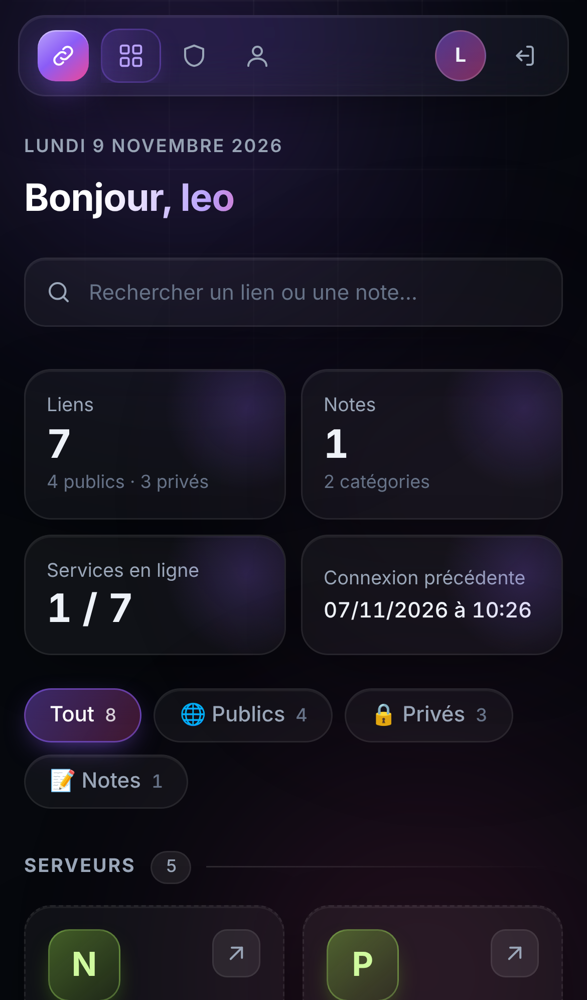

# Portail de liens

Tableau de bord personnel en PHP pour regrouper ses liens (sites publics **et** appareils du réseau local en IP:port) et des notes texte, derrière une connexion sécurisée avec **double authentification**.


## Fonctionnalités

- **Accès réservé aux comptes connectés** : mot de passe + code à 6 chiffres (Google Authenticator, Authy, Mots de passe d'iPhone…), activé obligatoirement à la première connexion.
- **Liens publics et privés** : tape `mail.mondomaine.fr` ou `192.168.1.20:8006`, le type est détecté tout seul (badge « Privé » pour le réseau local).
- **Notes texte** : mémos, commandes, plan d'adressage… avec bouton Copier.
- **Catégories**, **recherche** instantanée (touche `/`) et filtres Tout / Publics / Privés / Notes.
- **État des services** : pastille verte ou rouge pour chaque lien, vérifiée depuis le serveur.
- **Administration** : liens, notes, catégories, comptes (mot de passe provisoire, réinitialisation 2FA, droits admin) et journal de sécurité.
- **Alertes ntfy** sur le téléphone : connexion, essais ratés, code 2FA faux, adresse bloquée (onglet Administration → Sécurité).
- **Thème sombre**, adapté au téléphone.

| Double authentification | Administration | Mobile |
|---|---|---|
|  |  |  |

## Installation (Debian 13)

En **root** sur le serveur :

```bash
wget -qO install.sh https://raw.githubusercontent.com/leochgn-collab/portail-liens/main/install.sh
bash install.sh
```

Le script installe Apache, PHP 8.4 et SQLite, télécharge le portail dans `/var/www/portail-liens`, configure Apache et crée le compte administrateur. Il pose 5 questions :

| Question | Exemple |
|---|---|
| Domaine du portail | `leo44.cloud` |
| Nom affiché | `Leo44` |
| Accès : **1** derrière un reverse proxy (Zoraxy…) ou **2** direct avec certbot | `1` |
| IP du reverse proxy (choix 1) | `192.168.1.104` |
| Identifiant admin | `leo` |

À la fin, il affiche un **mot de passe provisoire**. Ouvre le site, connecte-toi, scanne le QR code, note tes codes de secours, puis choisis ton mot de passe.

### Avec Zoraxy

Dans Zoraxy, crée une règle de proxy `leo44.cloud → http://IP-du-serveur:80` et active le HTTPS. Le portail fait confiance à l'IP du proxy indiquée pendant l'installation pour connaître l'adresse réelle des visiteurs (utile pour bloquer les essais de mot de passe) et savoir que la connexion est chiffrée.

## Mise à jour

```bash
bash /var/www/portail-liens/install.sh
```

Les comptes, liens, notes et réglages sont conservés.

## Commandes utiles

```bash
P="runuser -u www-data -- php /var/www/portail-liens/bin/portail.php"
$P list                     # lister les comptes
$P create-admin nom         # créer un administrateur
$P reset-password nom       # nouveau mot de passe provisoire
$P reset-2fa nom            # téléphone perdu : reconfigurer la 2FA
$P bans                     # adresses IP bloquées
$P unban 1.2.3.4            # débloquer une adresse (unban all : tout débloquer)
```

## Réglages

Dans `/var/www/portail-liens/config.local.php` (créé par l'installation, jamais écrasé) :

```php
<?php
const APP_NAME = 'Leo44';
const TRUSTED_PROXIES = '192.168.1.104';
// const SESSION_IDLE = 1800;   // déconnexion après 30 min d'inactivité
// const STATUS_CHECK = false;  // désactiver les pastilles d'état
```

## Sécurité

- Mots de passe hachés en Argon2id, 12 caractères minimum.
- Secret 2FA chiffré (libsodium), codes à usage unique, 8 codes de secours.
- 5 erreurs par compte en 15 min : compte bloqué 15 min.
- 10 erreurs par IP en 15 min : adresse bloquée 15 min, puis 1 h, puis 24 h si elle recommence.
- Chaque essai raté est ralenti d'une seconde.
- Seules les méthodes GET et POST sont acceptées (PUT, DELETE… refusées).
- Jeton CSRF sur chaque formulaire, cookies `Secure` / `HttpOnly` / `SameSite`, CSP stricte sans script en ligne.
- Base SQLite et clé de chiffrement dans `data/`, **hors** du dossier publié par Apache.
- Journal des connexions et actions sensibles.

À savoir : les liens privés ne s'ouvrent que depuis le réseau local ou un VPN. Les notes sont visibles par tous les comptes connectés : n'y mets pas de mots de passe importants.

## Structure

```
public/      pages accessibles (seul dossier publié par Apache)
src/         configuration, base de données, sécurité, mise en page
bin/         outil en ligne de commande
data/        base SQLite, clé, sessions (créé à l'installation, non versionné)
install.sh   installation et mise à jour
```

## Licence

MIT. Le générateur de QR code (`public/assets/qrcode.js`) est de Kazuhiko Arase, sous licence MIT.

## Page « Conteneurs » (Proxmox)

Les administrateurs peuvent démarrer et arrêter proprement leurs CT Proxmox, et programmer des plages d'extinction (ex. éteint de 23:00 à 07:00), affichées sur une frise de 24 h. Le planificateur est lancé chaque minute par cron (`/etc/cron.d/portail-ct`, créé par `install.sh`).

1. Sur l'hôte Proxmox, crée un rôle et un jeton limités :
   ```bash
   pveum role add CTPower -privs "VM.PowerMgmt VM.Audit"
   pveum user token add root@pam portail --privsep 1
   pveum acl modify /vms --tokens 'root@pam!portail' --roles CTPower --propagate 1
   ```
2. Dans `config.local.php` du portail :
   ```php
   const PVE_URL   = 'https://192.168.1.203:8006';
   const PVE_TOKEN = 'root@pam!portail=LE_SECRET';
   ```

Le droit donné sur `/vms` couvre aussi les CT créés plus tard : le portail les détecte dans la minute, les affiche avec un badge « Nouveau » et envoie une alerte ntfy (de même quand un CT est supprimé).

Le CT du portail (106 par défaut, réglable avec `PVE_PROTECTED`) ne peut jamais être arrêté depuis la page.

## Bonus : alertes de connexion Proxmox

`extras/proxmox-ntfy.sh` envoie une notification ntfy quand quelqu'un se connecte à Proxmox (interface web ou SSH), ou se trompe de mot de passe. En root sur le serveur Proxmox :

```bash
wget -qO proxmox-ntfy.sh https://raw.githubusercontent.com/leochgn-collab/portail-liens/main/extras/proxmox-ntfy.sh
bash proxmox-ntfy.sh install
```
